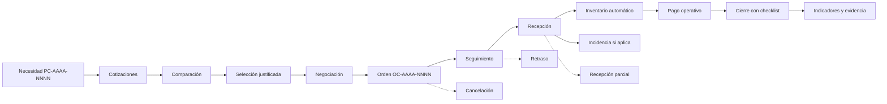

# Flujo operativo

## Estados del expediente

`borrador`, `pendiente_cotizacion`, `cotizando`, `evaluacion`, `negociacion`,
`proveedor_seleccionado`, `orden_emitida`, `seguimiento`,
`recepcion_parcial`, `recibido`, `pendiente_pago`, `completado` y `cancelado`.

El cierre no se ejecuta mediante un cambio arbitrario de estado. La aplicación
verifica proveedor, orden, recepción, incidencias y pago cuando corresponda.

## Reglas de continuidad

- La cotización seleccionada alimenta la negociación y la orden.
- La orden se relaciona con el expediente y no se genera dos veces.
- La recepción aceptada genera una entrada de inventario con origen.
- Los pagos conservan obligación, aplicaciones y saldo.
- Cada operación crítica deja un evento en el historial del expediente.
- Las incidencias se pueden actualizar entre `abierta`, `en_revision`,
  `resuelta` y `cancelada`; una resolución o justificación permite al checklist
  verificar los casos que sigan abiertos.

La creación de un expediente inicia en `pendiente_cotizacion`. Las
transiciones manuales se validan contra `PROCESS_TRANSITIONS`; las transiciones
automáticas que siguen a selección, recepción, pago y cierre también registran
eventos. Los estados terminales son `completado` y `cancelado`.
